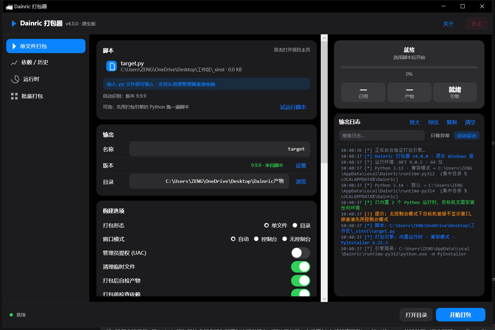
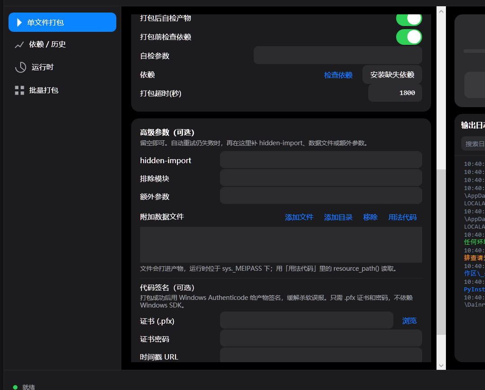
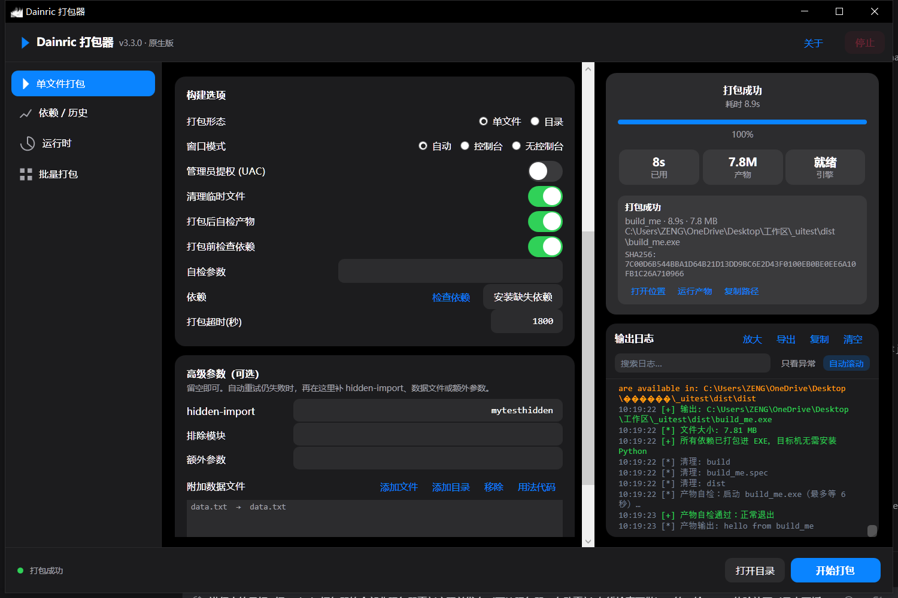
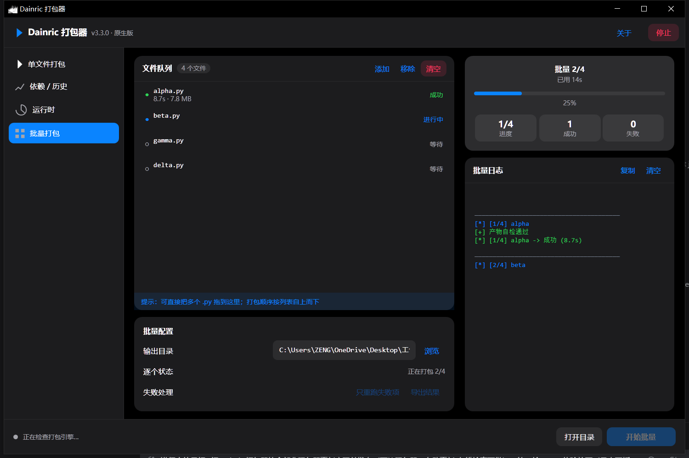

# Dainric 打包器

把 Python 脚本打包成独立 Windows EXE 的桌面工具，基于 **.NET 9 + WPF**。
内置 Python 3.12 / 3.14 运行时，目标机不需要安装 Python 或 NET；支持批量打包、
依赖检查、失败诊断与自动修复、产物自检、打包历史、日志落盘、代码签名和 CLI。

[](https://github.com/Dainric/DainricPacker/actions/workflows/build.yml)

> 当前版本：**v4.0.0** · [下载安装包/绿色版](https://github.com/Dainric/DainricPacker/releases/tag/v4.0.0)



## 功能

- 单文件 / 目录两种打包形态，图形界面开箱即用
- 内置 Python 3.12 / 3.14 运行时（安装包 / 绿色版自带）
- 打包前依赖检查；PyInstaller 失败后自动诊断并补参数重试
- 打包后自检：实际启动一次产物，确认真的能运行
- 高级参数：hidden-import、排除模块、`--add-data`、额外 PyInstaller 参数
- 数据文件向导：添加文件/目录，自动生成 `resource_path()` 代码
- 脚本识别：读取 `__version__`，识别 GUI / 命令行 / multiprocessing
- 打包历史（持久化）、日志搜索/过滤/放大/导出/自动落盘
- 结果卡片：大小、耗时、SHA256、打开/运行产物
- 批量打包：队列状态、只重跑失败项、导出 CSV
- 单实例 + 右键菜单「用 Dainric 打包」（安装版）
- 代码签名：使用 `.pfx` 证书给产物做 Windows Authenticode 签名
- CLI 模式：`--build app.py --out dist --json`，可用于脚本 / CI







## 使用

### 图形界面

安装后双击「Dainric 打包器」，把 `.py` 拖进窗口 → 选择输出目录 → 开始打包。
详细操作见 [使用说明.txt](使用说明.txt)。

### 命令行

```powershell
Dainric打包器.exe --build app.py --out dist --onedir --json
Dainric打包器.exe --help
```

常用参数：`--onefile/--onedir`、`--console/--noconsole`、`--icon`、
`--app-version`、`--hidden-import`、`--exclude-module`、`--add-data`、
`--sign-pfx/--sign-password` 等。

## 构建

需要：

- .NET 9 SDK
- Inno Setup 6（仅编译安装包时需要）
- Python 3.12 / 3.14 运行时（用于 PyInstaller 打包）

```bash
python 构建原生版.py
```

产物：

- `_native_selfcontained/DainricPacker.exe`：自包含单文件主程序
- `打包器-绿色版-v<版本>/`：绿色版（含 Python 运行时）
- `打包器-安装程序/Dainric打包器-安装程序-v<版本>.exe`：安装包

单元测试：

```bash
dotnet test 打包器-单元测试/DainricPacker.Tests/DainricPacker.Tests.csproj -c Release
```

自动化验证：

```bash
python 打包器-界面与报告/pack_smoke.py
python 打包器-界面与报告/ui_regression.py          # UI 截图
python 打包器-界面与报告/ui_regression.py --baseline # 更新基线
```

`pack_smoke.py` 需要安装版已安装；`ui_regression.py` 依赖 Pillow
（`pip install pillow`）。

## 仓库结构

```
打包器-C#源码/          C# / WPF 源码
打包器-C++源码/         C++ 原生版源码（src / tests）
打包器-单元测试/        xunit 单元测试
打包器-安装程序/        Inno Setup 安装脚本
打包器-界面与报告/      构建报告、UI 设计、验证脚本
docs/images/            README 截图
构建原生版.py           一键构建：publish → 绿色版 → 安装程序
使用说明.txt            终端用户使用说明
项目状态.md             开发记录与版本历史
```

> 安装包、绿色版运行时、历史截图、构建产物与密钥不进入 Git；
> 其中安装包/绿色版通过 [GitHub Releases](https://github.com/Dainric/DainricPacker/releases) 发布。

## 数据目录

```
%LOCALAPPDATA%\Programs\Dainric     程序安装位置
%LOCALAPPDATA%\Dainric               运行时 / 配置 / 历史 / 日志
```

## 常见问题

- **产物被杀软误报？** 这是 PyInstaller 单文件产物的常见问题，可改用「目录」形态，
  或在杀软中添加白名单；发布时给产物做代码签名也有帮助。
- **目标机需要 Python 吗？** 不需要，运行时已随程序自带。
- **支持 32 位系统吗？** 目前只提供 Windows x64。

## 许可

本项目使用 [MIT License](LICENSE)。

程序在打包用户脚本时会调用 PyInstaller / Python；发布由本工具生成的产物时，
请同时遵守 PyInstaller 与 Python 的相应许可证。
